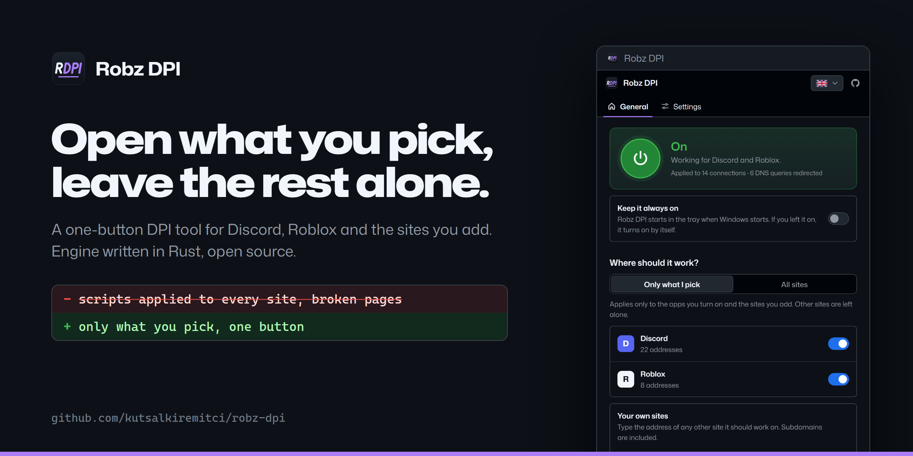
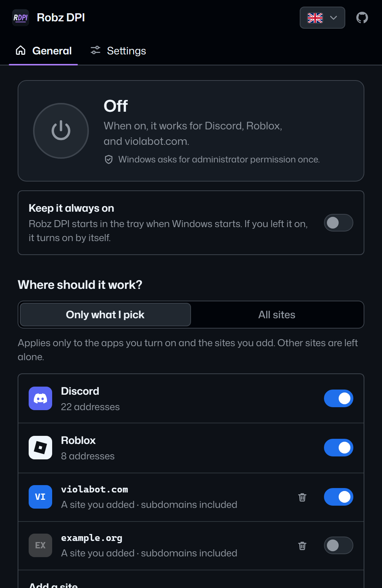
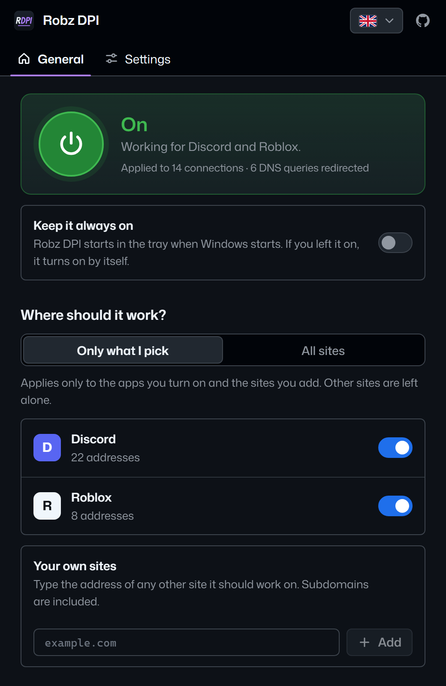
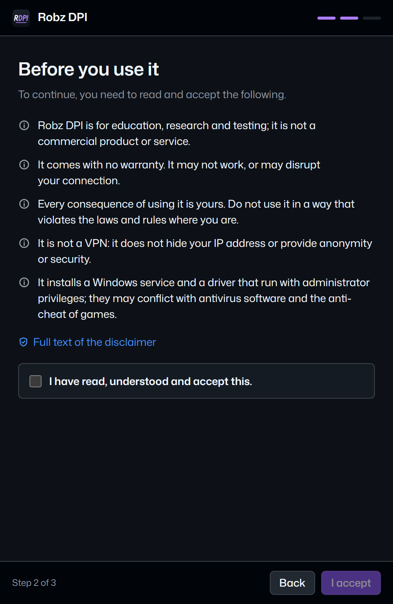
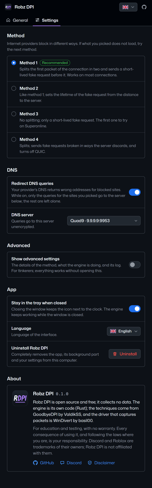
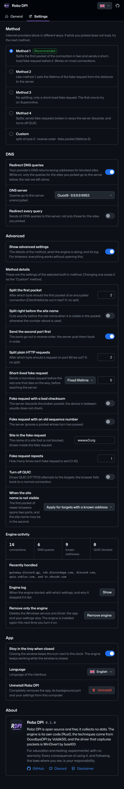

<p align="center">
  
</p>

<p align="center">
  <a href="https://github.com/kutsalkiremitci/robz-dpi/releases/latest"></a>
  <a href="https://github.com/kutsalkiremitci/robz-dpi/releases"></a>
  <a href="https://github.com/kutsalkiremitci/robz-dpi/stargazers"></a>
  <a href="LICENSE"></a>
  <br>
  
  
  
  
  
</p>

<p align="center">
  <a href="https://github.com/kutsalkiremitci/robz-dpi/releases/latest/download/RobzDPI-Setup.exe"></a>
  <a href="https://github.com/kutsalkiremitci/robz-dpi/stargazers"></a>
  <br>
  <a href="README.md"></a>
  <a href="README.ru.md"></a>
  <a href="https://discord.gg/UyyEn7SHm4"></a>
</p>

<h3 align="center">One button to turn it on. It works only on the sites you pick.</h3>

<p align="center">
  <b>Robz DPI</b> is a small Windows app, written in <b>Rust</b>, that lets you reach sites your internet provider<br>
  blocks with deep packet inspection (DPI). It does not route your connection through a server or slow it down:<br>
  it only sends the first packet of a connection in a form the device in between cannot recognize.
</p>

```diff
- Download a zip, work out which .cmd file to run, open it as administrator
- It applies to every site: some sites stop loading and you cannot tell why
- Edit a text file to add a site, edit flags to try another method
+ Install Robz DPI, press the button
+ It applies only to Discord, Roblox and the sites you add; the rest is left alone
+ Adding a site is typing an address into a box; changing the method is one click
```

> [!WARNING]
> **For education and testing; experimental.** Robz DPI is an open source project written to learn and study how
> network protocols and DPI systems work, and to try this on your own network. It comes with no warranty; every
> consequence of using it, and following the laws where you are, is your responsibility. Read the
> **[disclaimer](DISCLAIMER.md#english)** before using it.
>
> Its engine has not been tried on every internet provider. If it does not work for you,
> [open an issue](https://github.com/kutsalkiremitci/robz-dpi/issues): that is the only way to learn which method
> works on which connection.

## Contents

- [What it does](#what-it-does)
- [Start in 3 steps](#start-in-3-steps)
- [User guide](#user-guide)
- [If it does not work](#if-it-does-not-work)
- [How it works](#how-it-works)
- [How it differs from GoodbyeDPI](#how-it-differs-from-goodbyedpi)
- [Security and privacy](#security-and-privacy)
- [FAQ](#faq)
- [Development](#development)
- [Thanks](#thanks)
- [Support and contributing](#support-and-contributing)
- [Disclaimer](#disclaimer)

## What it does

<table>
  <tr>
    <td width="33%" valign="top"><b>One button</b><br>
      On, off. Windows asks for administrator permission once, the first time; turning it on and off later does not ask.</td>
    <td width="33%" valign="top"><b>Only what you pick</b><br>
      Discord and Roblox come ready. Other sites are left alone, so you do not get "that site stopped loading".</td>
    <td width="33%" valign="top"><b>Your own sites</b><br>
      Another site? Type its address into the box and add it. No files to edit, no flags to memorize.</td>
  </tr>
  <tr>
    <td valign="top"><b>Everywhere, if you want</b><br>
      "All sites" mode works like GoodbyeDPI Turkey: it applies to every connection, without a list.</td>
    <td valign="top"><b>Four built-in methods</b><br>
      Providers block in different ways. If one does not work, pick the next; the connection test shows the result at once.</td>
    <td valign="top"><b>Fixes DNS too</b><br>
      Redirects the DNS queries of blocked sites to the server you choose. Only the queries for your sites are touched.</td>
  </tr>
  <tr>
    <td valign="top"><b>Always on</b><br>
      If you like, it starts in the tray with Windows and turns on by itself when you left it on.</td>
    <td valign="top"><b>An advanced section for tinkerers</b><br>
      Every detail of the method, what the engine is doing, and its log. Everything works without opening it.</td>
    <td valign="top"><b>Open source, collects no data</b><br>
      No account, ads or usage statistics. All the code, engine included, is in this repository. Turkish, English
      and Russian.</td>
  </tr>
</table>

<p align="center">
  
  
  
</p>

## Start in 3 steps

1. **Download:** [RobzDPI-Setup.exe](https://github.com/kutsalkiremitci/robz-dpi/releases/latest/download/RobzDPI-Setup.exe)
   (always the latest version).
2. **Install:** run the file. The installer does not ask for administrator permission and takes a few seconds.
3. **Turn it on:** the first time it opens, Robz DPI shows three short steps: language, accepting the disclaimer,
   and where it should work. Then press the big button. Windows asks "do you want to allow this app to make changes?";
   say **Yes**. The button turns green: Discord and Roblox now load.

> [!IMPORTANT]
> If **GoodbyeDPI** or a similar tool is running on your computer, close it first. Two tools modify the same packet
> twice and connections break. Robz DPI notices a running GoodbyeDPI, warns you, and can stop it for you.

## User guide

### General

- **The big button** turns the engine on and off. While on, it shows what it applies to and how many connections it
  has handled.
- **Keep it always on:** Robz DPI starts in the tray when Windows starts. If you left the engine on, it turns on by
  itself; if you left it off, it stays off.
- **Where should it work?**
  - **Only what I pick** (recommended): applies only to the apps whose switch is on and the sites you add.
  - **All sites:** applies to every connection. Some sites do not accept a split connection and stop loading; if
    that happens, go back to "Only what I pick".
- **Your own sites:** type the address (`example.com`, or paste a link) and press **Add**. Subdomains
  (`cdn.example.com`) are covered automatically. You can add several addresses at once, separated by spaces.
- **Connection test:** tries a real connection to what you picked, from this computer.

If you change a setting while the engine is running, a blue box appears: press **Apply** for the new setting to take
effect (changing settings asks for administrator permission; turning on and off does not).

### Settings

- **Method:** there are four built-in methods. Method 1 works on most connections. If it does not, try the others in
  order and check the connection test after each.
- **DNS:** your provider's DNS returns wrong addresses for blocked sites. Robz DPI redirects the queries for those
  sites to the server you choose (Quad9, Yandex, AdGuard, OpenDNS, or your own). Queries are not encrypted.
- **Stay in the tray when closed**, **language** and **Uninstall Robz DPI** are here too.

### Advanced

Turning on "Show advanced settings" adds three things:

- **Method details:** after which byte the first packet is split, the order of the parts, the kind and lifetime of
  the fake request, the site shown in the fake request, turning off QUIC, and what to do for connections whose site
  name is not visible. Changing a setting of a built-in method copies it as "Custom"; the built-in methods stay intact.
- **Engine activity:** how many connections it was applied to, how many DNS queries were redirected, and which site
  names were handled last.
- **Engine log:** when the engine started, with which filter, and why it stopped if it did.

<p align="center">
  
  
</p>

### Tray icon

Closing the window keeps Robz DPI in the icon next to the clock. Right-click it for **Turn on** / **Turn off**. The
engine is a separate Windows service: it keeps running until you turn it off, even if you quit Robz DPI entirely.

## If it does not work

<details>
<summary><b>The button is green but Discord or a site still does not load</b></summary>

1. Press **Connection test**. If it says "Not reachable", pick **the next method** in Settings, press **Apply** and
   test again. Try all four.
2. Check that **Redirect DNS queries** is on. If it is, pick another **DNS server** and try again.
3. If "Secure DNS" (DoH) is on in your browser, DNS is not the problem; focus on the method.
4. If nothing helps, look at **Engine activity** under Advanced: is the connection count going up? If not, the
   engine is not seeing that site (the address may be wrong). If it goes up but the site does not load, the method
   does not work on that connection: [open an issue](https://github.com/kutsalkiremitci/robz-dpi/issues) with your
   provider and the engine log.

</details>

<details>
<summary><b>It says "The engine could not start" or "The engine stopped by itself"</b></summary>

The reason is shown under the message. The most common ones:

- **A security program blocked the driver:** add an exception for Robz DPI in your antivirus. Some antivirus
  products (Kaspersky in particular, according to GoodbyeDPI users) may block WinDivert despite an exception.
- **An incompatible version of WinDivert is loaded:** close the program using it (an old GoodbyeDPI, zapret) and
  restart the computer.
- **Windows did not accept the driver's signature:** update Windows.

</details>

<details>
<summary><b>"Windows protected your PC" appears</b></summary>

The installer is not signed with a paid certificate, so Windows SmartScreen shows this warning to early downloaders.
Continue with **More info** → **Run anyway**. To check that the file came from this repository, compare it with
`SHA256SUMS.txt` on the release page.

</details>

<details>
<summary><b>My antivirus raised a warning</b></summary>

Robz DPI uses the [WinDivert](https://github.com/basil00/WinDivert) driver to capture packets. Like any tool that
can modify network traffic, WinDivert is flagged as a "risky tool" by some antivirus products; this happens with
every program that uses it, GoodbyeDPI included. The bundled WinDivert files are the official release and are
verified by their SHA-256 digests ([`engine.lock.json`](engine.lock.json)).

</details>

<details>
<summary><b>Some sites do not load in "All sites" mode</b></summary>

Some sites reject a connection that was split in two. This is inherent to the technique, and it is why Robz DPI
applies only to the sites you pick by default. Go back to "Only what I pick" and add the sites you want.

</details>

<details>
<summary><b>How do I remove Robz DPI completely?</b></summary>

Settings → **Uninstall Robz DPI**. It removes everything in one step: the app, its background part (the Windows
service, the WinDivert driver, the `Program Files\RobzDPI` folder) and your settings. Because the background part was
installed with administrator privileges, Windows asks for approval once.

Uninstalling from the Windows "Apps" list does the same: the uninstaller removes the background part too. If you
answer "No" to the approval prompt, the app is still uninstalled but the service stays.

</details>

## How it works

When you connect to a site, your browser first sends a packet that contains the site's name (the TLS ClientHello).
Your provider's device reads the name in that packet and cuts the connection if the site is blocked. Robz DPI sends
that packet in a form the device cannot recognize but the site's server understands without trouble:

1. **It splits it.** The packet is cut into two parts and the second part is sent first. The server puts the parts
   in order; the device in between never sees the name in one piece.
2. **It puts a fake request in front.** It sends a fake packet carrying the name of a site that is not blocked. That
   packet either dies on the way before reaching the server (short lifetime) or is broken in a way the server
   discards; the device in between takes it for the real one.
3. **It fixes DNS.** It redirects the address query for a blocked site to a server and port your provider cannot
   interfere with, and hands the answer back to the app as if it came from where the app asked.

It does not touch the rest of the connection (whatever you download, watch or say): there is no speed loss and your
traffic does not go through another server. That is why it is not a VPN: it does not hide your IP address, it only
gets past the block.

The engine has two parts. The signed driver that takes packets from the kernel and puts them back is **WinDivert**
(basil00, open source). The code that decides what to do with a packet is in this repository
([`src-tauri/src/engine`](src-tauri/src/engine)):

| File | What it does |
|---|---|
| `packet.rs` | Reads, splits and rebuilds IP, TCP and UDP packets; computes checksums |
| `tls.rs` | Reads the site name from a ClientHello; builds the fake ClientHello |
| `dnsmsg.rs` | Reads the name in a DNS query and the addresses in an answer |
| `logic.rs` | The decision: what happens to this packet? (pure logic, tested without touching the network) |
| `filter.rs` | The filter given to the driver: which packets reach the engine? |
| `divert.rs` | WinDivert binding |
| `service.rs` | The Windows service: take a packet, decide, put it back |

## How it differs from GoodbyeDPI

Robz DPI's techniques come from [GoodbyeDPI](https://github.com/ValdikSS/GoodbyeDPI); they were re-implemented in
Rust by reading its source. The four built-in methods behave like the flag sets in the scripts of
[GoodbyeDPI-Turkey](https://github.com/cagritaskn/GoodbyeDPI-Turkey):

| Robz DPI | GoodbyeDPI equivalent |
|---|---|
| Method 1 | `-5 --set-ttl 5` |
| Method 2 | `-5` |
| Method 3 | `--set-ttl 3` |
| Method 4 | `-9` |

Writing the engine from scratch changed these things:

| | GoodbyeDPI | Robz DPI |
|---|---|---|
| Packets that reach the engine | Every packet under 1200 bytes going to ports 80 and 443 | Only the first packet of a connection (ClientHello); the selection happens in the driver |
| DNS redirection | All queries | Only the queries for the sites you picked (all, if you want) |
| When the site name is in the second packet | In list mode the connection is left alone | Recognizes the target's address from the DNS answer and applies |
| Code that reads packets | C | Safe Rust (no `unsafe`), tested with malformed input |
| Auto lifetime, server 3 hops away | The number overflows; the fake packet can reach the server | Fixed |
| What "running" means | The process started | The driver really opened; if it cannot, it says why |
| Changing settings | Command-line flags, a text file | The interface |

GoodbyeDPI is a proven program that has been in use for years; Robz DPI is new. If GoodbyeDPI works for you and
Robz DPI does not with the same method, that is our bug: please
[report it](https://github.com/kutsalkiremitci/robz-dpi/issues).

## Security and privacy

- **It collects no data.** No account, ads, usage statistics or update checks. Robz DPI goes on the network in two
  cases only: to the sites you picked when you press "Connection test", and to the DNS server you chose while DNS
  redirection is on.
- **The engine only modifies the packet.** It does not read, store or send the content anywhere. Connections are not
  decrypted; encrypted traffic cannot be looked into.
- **The only third-party binary is WinDivert.** It is downloaded from the official release, its SHA-256 digests are
  pinned in [`engine.lock.json`](engine.lock.json), and it is verified both at build time and when the engine is
  installed. The engine itself is compiled from the code in this repository.
- **Administrator permission only when needed.** The interface runs without privileges. Installing the engine and
  changing its settings asks for Windows approval (UAC); that work is done in a separate, windowless helper mode,
  and every value coming from the interface is validated again. No free text or command-line flags are accepted.
- **The service runs from a protected folder.** The engine is copied to `Program Files\RobzDPI`, which only
  administrators can modify. The signed-in user can start and stop the service but cannot change the program it runs.
- **The interface is a closed box.** It cannot run scripts from outside and reaches Windows through a single command.

## FAQ

<details>
<summary><b>Is Robz DPI paid?</b></summary>

No. It is free and open source (MIT). There is no paid version, no ads and no account.

</details>

<details>
<summary><b>Is this a VPN? Will my internet slow down?</b></summary>

It is not a VPN. Your traffic does not go through another server, your IP address does not change, and your speed
does not drop. Robz DPI touches only the first packet of each connection; the rest takes its normal route.

</details>

<details>
<summary><b>Does voice on Discord and gameplay on Roblox work?</b></summary>

Voice and game traffic take a separate route (UDP) and Robz DPI does not touch it. Blocks are mostly applied when
connecting to the site and the sign-in servers, so voice and gameplay are expected to work once those load; but this
has not been tried on every connection. If it does not work for you,
[report it](https://github.com/kutsalkiremitci/robz-dpi/issues).

</details>

<details>
<summary><b>Which sites can I add?</b></summary>

Any site you want. Robz DPI does not ship a list of blocked sites; Discord and Roblox are only ready-made shortcuts.

</details>

<details>
<summary><b>Does it work on macOS or Linux?</b></summary>

Only Windows 10 and 11 (64-bit) for now. The packet logic compiles and is tested on every platform; what is missing
is the layer that captures packets on those systems. macOS is the next target.

</details>

<details>
<summary><b>Is it legal?</b></summary>

That depends on where you are and what you use the software for; this repository does not give legal advice. Robz
DPI is a network tool for education and testing: how and where it is used is the user's responsibility. Knowing and
following the laws and the court and administrative decisions where you are is up to you. If in doubt, do not use it
and consult a lawyer. Details: [disclaimer](DISCLAIMER.md#english).

</details>

## Development

**Requirements:** [Rust](https://rustup.rs) (MSVC), Node.js 22+, the Visual Studio C++ tools and the Windows SDK
(Tauri's [Windows prerequisites](https://tauri.app/start/prerequisites/)).

```powershell
npm install          # copies the interface libraries, downloads and verifies WinDivert
npm run dev          # open in development mode
npm test             # interface (node --test) and Rust (cargo test) tests
npm run build        # installer: src-tauri/target/release/bundle/nsis/
```

- **The engine is tested without touching the network.** `logic.rs` is pure logic: the tests feed it hand-built
  packets and check the packets that come out (order, split point, lifetime, checksum). The filters are compiled
  with the real `WinDivert.dll` and applied to sample packets; the driver is not loaded.
- **The interface can be tried in a browser.** Serve the `ui/` folder with any local server (`python -m http.server
  --directory ui`) and a mock core ([`ui/js/dev-mock.js`](ui/js/dev-mock.js)) takes the place of the real one: the
  design can be tried without touching the computer.
- `node scripts/screenshots.mjs` regenerates [`docs/screenshots`](docs/screenshots) in three languages; `node
  scripts/render-banners.mjs` redraws the README images.
- `node site/build.mjs` builds the three-language one-page website into [`site/dist`](site); each language page
  uses the screenshots in that language.

```
engine.lock.json     the official WinDivert release and its SHA-256 digests
ui/                  interface: plain ES modules, Preact + htm, no bundler
  js/locales/        Turkish and English text
src-tauri/src/
  main.rs            entry: interface, --helper (administrator helper) or --engine (the engine)
  settings.rs        settings and validation
  catalog.rs         built-in apps, methods, DNS servers
  plan.rs            from settings to an engine request; the strategy and its validation
  dpi.rs             app state: turn on, turn off, apply, test
  probe.rs           connection test
  shell.rs           window, tray, starting with Windows
  engine/            the engine (table above) + helper.rs (administrator helper), scm.rs (Windows services)
```

**Releasing:** set the same version number in `package.json`, `src-tauri/Cargo.toml` and
`src-tauri/tauri.conf.json`, write the notes in [`CHANGELOG.md`](CHANGELOG.md) and push a `vX.Y.Z` tag. The workflow
builds the installer and publishes it as `RobzDPI-Setup-X.Y.Z.exe` and `RobzDPI-Setup.exe`.

## Thanks

- **[GoodbyeDPI](https://github.com/ValdikSS/GoodbyeDPI)** (ValdikSS): the source of the techniques. Robz DPI's
  engine was written by reading its source code.
- **[GoodbyeDPI-Turkey](https://github.com/cagritaskn/GoodbyeDPI-Turkey)** (Çağrı Taşkın): the flag sets that work
  for internet providers in Turkey.
- **[WinDivert](https://github.com/basil00/WinDivert)** (basil00): the driver that captures packets.

License details: [THIRD-PARTY-NOTICES.md](THIRD-PARTY-NOTICES.md).

## Support and contributing

- **Stuck during setup?** There is free support on the [Discord](https://discord.gg/UyyEn7SHm4) server.
- **Did it not work, or do you have an idea?** [Open an issue](https://github.com/kutsalkiremitci/robz-dpi/issues).
  Including your provider, the methods you tried and the engine log makes it much faster to solve.
- **If you like it,** starring the repository helps more people find the project.

Contributions are welcome: send a pull request for code, translations, a new method, or what works on a given
provider.

## Disclaimer

Full text: **[DISCLAIMER.md](DISCLAIMER.md#english)** (Turkish, English, Russian). Downloading, installing or using
Robz DPI means you accept that text; the app also asks for your acceptance the first time it opens. In short:

- **For education, research and testing.** It was written to learn how network protocols and DPI systems work and to
  try this on your own network. It is not a commercial product or service.
- **No warranty.** It is provided as is; there is no guarantee that it works, gives access to any site, or does no
  harm.
- **The user is responsible.** All legal, administrative, criminal, financial and technical consequences of using it
  belong to the user. Do not use it in a way that violates the laws or the court and administrative decisions where
  you are.
- **It encourages no one.** The project owner and contributors do not direct anyone to violate laws, access
  restrictions or the terms of service of third-party services. The software contains no list of "blocked sites";
  the user decides which domain names it applies to.
- **It is not a service.** It is not a VPN, proxy or access service; traffic does not pass through any server
  belonging to the project and no content is hosted. It does not hide your IP address or provide anonymity or
  security.
- **It has technical risks.** It uses a service with administrator privileges and a kernel driver; connection
  interruptions, conflicts with other software and trouble with the anti-cheat systems of games are possible.
- **No affiliation with third parties.** Discord and Roblox are trademarks of their owners; this project is not
  affiliated with or endorsed by them.

## License

[MIT](LICENSE). WinDivert is distributed under its own license (LGPL-3.0 or GPL-2.0); GoodbyeDPI, the source of the
techniques, is licensed under Apache-2.0. Details: [THIRD-PARTY-NOTICES.md](THIRD-PARTY-NOTICES.md).
