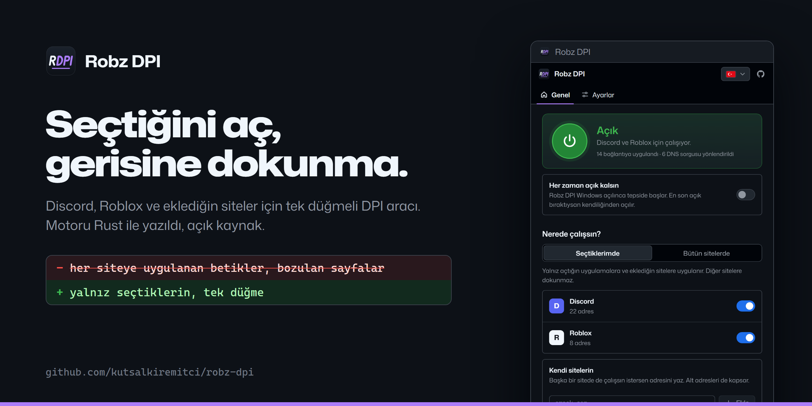
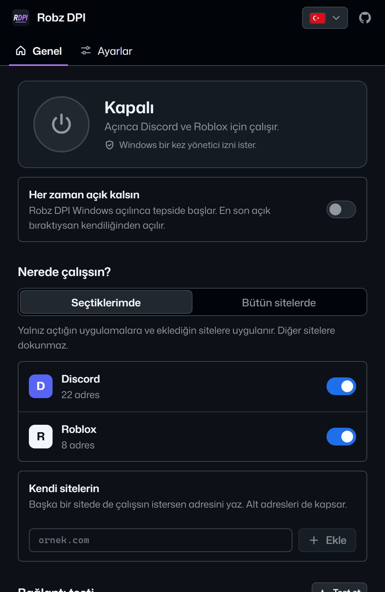
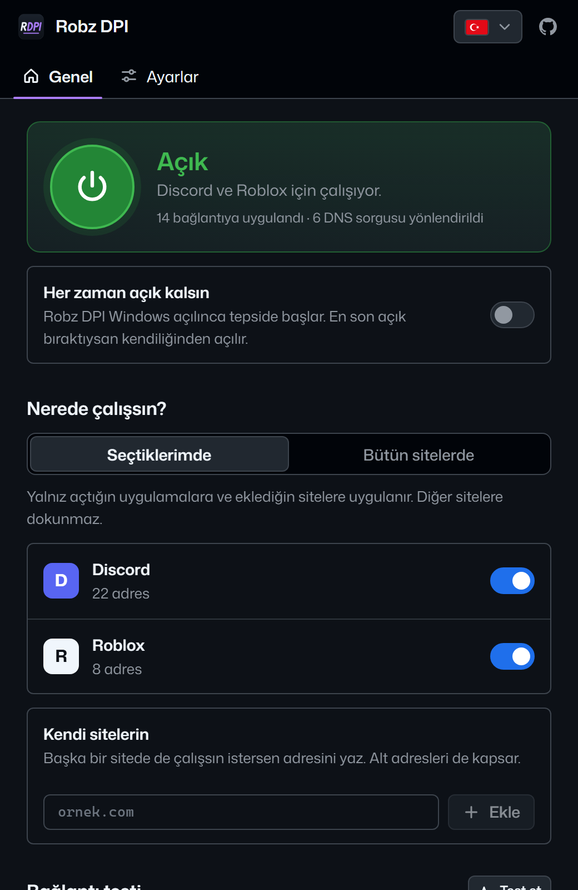
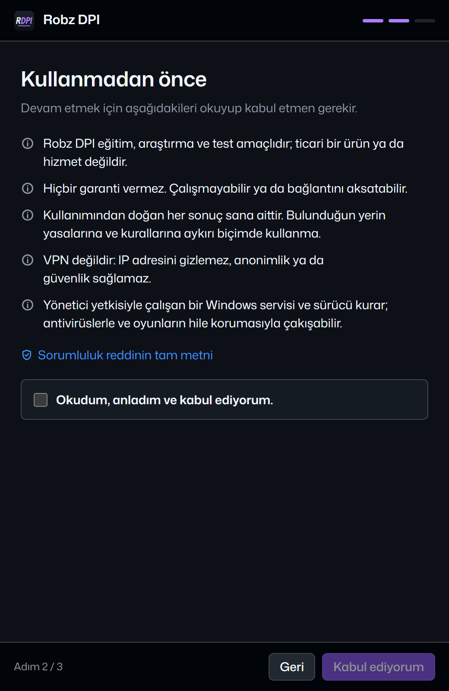
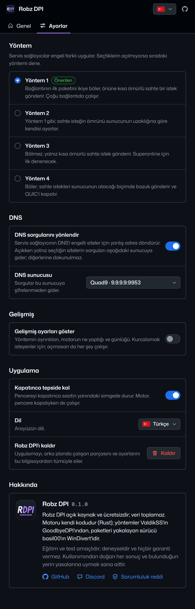
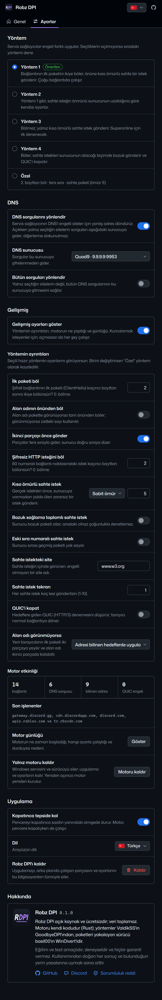

<p align="center">
  
</p>

<p align="center">
  <a href="https://github.com/kutsalkiremitci/robz-dpi/releases/latest"></a>
  <a href="https://github.com/kutsalkiremitci/robz-dpi/releases"></a>
  <a href="https://github.com/kutsalkiremitci/robz-dpi/stargazers"></a>
  <a href="LICENSE"></a>
  <br>
  
  
  
  
  
</p>

<p align="center">
  <a href="https://github.com/kutsalkiremitci/robz-dpi/releases/latest/download/RobzDPI-Setup.exe"></a>
  <a href="https://github.com/kutsalkiremitci/robz-dpi/stargazers"></a>
  <br>
  <a href="README.en.md"></a>
  <a href="README.ru.md"></a>
  <a href="https://discord.gg/UyyEn7SHm4"></a>
</p>

<h3 align="center">Tek düğmeyle aç. Yalnız seçtiğin sitelerde çalışsın.</h3>

<p align="center">
  <b>Robz DPI</b>, servis sağlayıcının derin paket incelemesiyle (DPI) kapattığı sitelere ulaşmanı sağlayan,<br>
  <b>Rust</b> ile yazılmış küçük bir Windows uygulamasıdır. Bağlantını bir sunucudan geçirmez, hızını düşürmez:<br>
  yalnız bağlantının ilk paketini, aradaki cihazın tanıyamayacağı biçimde gönderir.
</p>

```diff
- Zip indir, hangi .cmd dosyasını çalıştıracağını bul, yönetici olarak aç
- Bütün sitelere uygulanır: bazı siteler açılmaz, neden olduğunu bilemezsin
- Başka bir site eklemek için metin dosyası, başka bir yöntem için bayrak düzenle
+ Robz DPI'ı kur, düğmeye bas
+ Yalnız Discord, Roblox ve eklediğin sitelere uygulanır; gerisine dokunmaz
+ Site eklemek bir kutuya adres yazmak, yöntem değiştirmek bir tık
```

> [!WARNING]
> **Eğitim ve test amaçlıdır; deneyseldir.** Robz DPI, ağ protokollerinin ve DPI sistemlerinin nasıl çalıştığını
> öğrenmek, incelemek ve kendi ağında denemek için yazılmış açık kaynak bir projedir. Hiçbir garanti vermez;
> kullanımından doğan her sonuç ve bulunduğun yerin yasalarına uymak sana aittir. Kullanmadan önce
> **[sorumluluk reddini](DISCLAIMER.md)** oku.
>
> Motoru her servis sağlayıcıda denenmedi. Sende çalışmazsa
> [sorun bildir](https://github.com/kutsalkiremitci/robz-dpi/issues): hangi yöntemin hangi bağlantıda çalıştığını
> öğrenmenin tek yolu budur.

## İçindekiler

- [Neler yapar](#neler-yapar)
- [3 adımda başla](#3-adımda-başla)
- [Kullanım kılavuzu](#kullanım-kılavuzu)
- [Açılmıyorsa](#açılmıyorsa)
- [Nasıl çalışır](#nasıl-çalışır)
- [GoodbyeDPI'dan farkı](#goodbyedpidan-farkı)
- [Güvenlik ve gizlilik](#güvenlik-ve-gizlilik)
- [Sık sorulanlar](#sık-sorulanlar)
- [Geliştirme](#geliştirme)
- [Teşekkür](#teşekkür)
- [Destek ve katkı](#destek-ve-katkı)
- [Sorumluluk reddi](#sorumluluk-reddi)

## Neler yapar

<table>
  <tr>
    <td width="33%" valign="top"><b>Tek düğme</b><br>
      Aç, kapat. Windows ilk açışta bir kez yönetici izni ister; sonraki açıp kapamalarda sormaz.</td>
    <td width="33%" valign="top"><b>Yalnız seçtiklerinde</b><br>
      Discord ve Roblox hazır gelir. Diğer sitelere dokunmadığı için "şu site artık açılmıyor" sorunu yaşamazsın.</td>
    <td width="33%" valign="top"><b>Kendi sitelerin</b><br>
      Başka bir site mi? Adresini kutuya yaz, ekle. Dosya düzenlemek, bayrak ezberlemek yok.</td>
  </tr>
  <tr>
    <td valign="top"><b>İstersen her yerde</b><br>
      "Bütün sitelerde" kipi GoodbyeDPI Türkiye gibi çalışır: liste tutmadan her bağlantıya uygular.</td>
    <td valign="top"><b>Dört hazır yöntem</b><br>
      Servis sağlayıcılar farklı engeller. Biri çalışmazsa sıradakini seç; bağlantı testi sonucu hemen gösterir.</td>
    <td valign="top"><b>DNS'i de düzeltir</b><br>
      Engelli sitelerin DNS sorgularını seçtiğin sunucuya yönlendirir. Yalnız seçtiğin sitelerin sorgularına dokunur.</td>
  </tr>
  <tr>
    <td valign="top"><b>Her zaman açık</b><br>
      İstersen Windows açılınca tepside başlar ve en son açık bıraktıysan kendiliğinden açılır.</td>
    <td valign="top"><b>Meraklısına gelişmiş bölüm</b><br>
      Yöntemin her ayrıntısı, motorun ne yaptığı ve günlüğü. Açmasan da her şey çalışır.</td>
    <td valign="top"><b>Açık kaynak, veri toplamaz</b><br>
      Hesap, reklam, kullanım istatistiği yok. Motoru dahil bütün kod bu depoda. Türkçe, İngilizce ve Rusça.</td>
  </tr>
</table>

<p align="center">
  
  
  
</p>

## 3 adımda başla

1. **İndir:** [RobzDPI-Setup.exe](https://github.com/kutsalkiremitci/robz-dpi/releases/latest/download/RobzDPI-Setup.exe)
   (her zaman en son sürüm).
2. **Kur:** dosyayı çalıştır. Kurulum yönetici izni istemez ve birkaç saniye sürer.
3. **Aç:** Robz DPI ilk açılışta üç kısa adım gösterir: dil, sorumluluk reddinin onayı ve nerede çalışacağı.
   Ardından büyük düğmeye bas. Windows "bu uygulamanın değişiklik yapmasına izin veriyor musun?" diye
   sorar; **Evet** de. Düğme yeşile döner: Discord ve Roblox artık açılır.

> [!IMPORTANT]
> Bilgisayarında **GoodbyeDPI** ya da benzeri bir araç çalışıyorsa önce onu kapat. İki araç aynı paketi iki kez
> değiştirir ve bağlantılar bozulur. Robz DPI çalışan GoodbyeDPI'ı görür, uyarır ve istersen senin için durdurur.

## Kullanım kılavuzu

### Genel

- **Büyük düğme** motoru açar ve kapatır. Açıkken altında neye uygulandığı ve kaç bağlantıya dokunduğu yazar.
- **Her zaman açık kalsın:** Robz DPI Windows açılınca tepside başlar. Motoru en son açık bıraktıysan kendiliğinden
  açılır; kapalı bıraktıysan kapalı kalır.
- **Nerede çalışsın?**
  - **Seçtiklerimde** (önerilen): yalnız anahtarı açık uygulamalara ve eklediğin sitelere uygulanır.
  - **Bütün sitelerde:** her bağlantıya uygulanır. Bazı siteler bölünmüş bağlantıyı kabul etmez ve açılmaz; öyle
    olursa "Seçtiklerimde"ye dön.
- **Kendi sitelerin:** adresi yaz (`ornek.com` ya da doğrudan bir bağlantı yapıştır), **Ekle**'ye bas. Alt adresler
  (`cdn.ornek.com`) kendiliğinden kapsanır. Birden çok adresi boşlukla ayırıp tek seferde ekleyebilirsin.
- **Bağlantı testi:** seçtiklerine bu bilgisayardan ulaşılıp ulaşılamadığını gerçek bir bağlantıyla dener.

Motor çalışırken bir ayarı değiştirirsen mavi bir kutu çıkar: **Uygula**'ya basınca yeni ayar geçerli olur
(ayar değişikliği yönetici izni ister; açıp kapamak istemez).

### Ayarlar

- **Yöntem:** dört hazır yöntem vardır. Yöntem 1 çoğu bağlantıda çalışır. Çalışmazsa sırayla diğerlerini dene ve her
  birinden sonra bağlantı testine bak.
- **DNS:** servis sağlayıcının DNS'i engelli siteler için yanlış adres döndürür. Robz DPI bu sitelerin sorgularını
  seçtiğin sunucuya (Quad9, Yandex, AdGuard, OpenDNS ya da kendi yazdığın) yönlendirir. Sorgular şifrelenmez.
- **Kapatınca tepside kal**, **dil** ve **Robz DPI'ı kaldır** da buradadır.

### Gelişmiş

"Gelişmiş ayarları göster"i açınca üç şey gelir:

- **Yöntemin ayrıntıları:** ilk paketin kaçıncı bayttan bölüneceği, parçaların sırası, sahte isteğin türü ve ömrü,
  sahte istekte görünen site, QUIC'in kapatılması, alan adı görünmeyen bağlantılarda ne yapılacağı. Hazır bir
  yöntemin ayarını değiştirirsen o yöntem "Özel" olarak kopyalanır; hazır yöntemler bozulmaz.
- **Motor etkinliği:** kaç bağlantıya uygulandı, kaç DNS sorgusu yönlendirildi, en son hangi alan adları işlendi.
- **Motor günlüğü:** motor ne zaman başladı, hangi süzgeçle çalışıyor, durduysa neden durdu.

<p align="center">
  
  
</p>

### Tepsi simgesi

Pencereyi kapatınca Robz DPI saatin yanındaki simgede durur. Simgeye sağ tıklayıp **Aç** / **Kapat** diyebilirsin.
Motor ayrı bir Windows servisidir: Robz DPI'dan tümüyle çıksan da sen kapatana kadar çalışır.

## Açılmıyorsa

<details>
<summary><b>Düğme yeşil ama Discord ya da site hâlâ açılmıyor</b></summary>

1. **Bağlantı testi**ne bas. "Açılmıyor" diyorsa Ayarlar'dan **sıradaki yöntemi** seç, **Uygula**'ya bas, yeniden
   test et. Dört yöntemi de dene.
2. **DNS sorgularını yönlendir** açık mı bak. Açıksa başka bir **DNS sunucusu** seçip yeniden dene.
3. Tarayıcında "Güvenli DNS" (DoH) açıksa sorun DNS'te değildir; yönteme odaklan.
4. Hiçbiri olmadıysa Gelişmiş bölümünde **Motor etkinliği**ne bak: bağlantı sayısı artıyor mu? Artmıyorsa motor o
   siteyi görmüyordur (adresi yanlış eklenmiş olabilir). Artıyor ama site açılmıyorsa yöntem o bağlantıda işe
   yaramıyordur: [sorun bildir](https://github.com/kutsalkiremitci/robz-dpi/issues), servis sağlayıcını ve motor
   günlüğünü ekle.

</details>

<details>
<summary><b>"Motor başlatılamadı" ya da "Motor kendiliğinden durdu" yazıyor</b></summary>

Kutunun altında nedeni yazar. En sık görülenler:

- **Bir güvenlik yazılımı sürücüyü engelledi:** antivirüsünde Robz DPI için istisna tanımla. Bazı antivirüsler
  (GoodbyeDPI kullanıcılarının bildirdiğine göre özellikle Kaspersky) WinDivert'i istisnaya rağmen engelleyebilir.
- **Uyumsuz bir WinDivert sürümü yüklü:** onu kullanan programı (eski bir GoodbyeDPI, zapret) kapatıp bilgisayarı
  yeniden başlat.
- **Windows sürücünün imzasını kabul etmedi:** Windows'unu güncelle.

</details>

<details>
<summary><b>"Windows kişisel bilgisayarınızı korudu" uyarısı çıkıyor</b></summary>

Kurulum dosyası ücretli bir sertifikayla imzalanmadığı için Windows SmartScreen ilk indirenlere bu uyarıyı gösterir.
**Ek bilgi** → **Yine de çalıştır** ile devam edebilirsin. Dosyanın bu depodan geldiğini doğrulamak istersen sürüm
sayfasındaki `SHA256SUMS.txt` ile karşılaştır.

</details>

<details>
<summary><b>Antivirüsüm uyarı verdi</b></summary>

Robz DPI paketleri yakalamak için [WinDivert](https://github.com/basil00/WinDivert) sürücüsünü kullanır. Ağ trafiğini
değiştirebilen her araç gibi WinDivert de bazı antivirüslerde "riskli araç" diye işaretlenir; bu, GoodbyeDPI dahil onu
kullanan bütün programlarda görülür. Pakete giren WinDivert dosyaları resmi sürümdür ve SHA-256 özetleriyle
doğrulanır ([`engine.lock.json`](engine.lock.json)).

</details>

<details>
<summary><b>"Bütün sitelerde" kipinde bazı siteler açılmıyor</b></summary>

Bazı siteler ikiye bölünmüş bağlantıyı reddeder. Bu, yöntemin doğası gereğidir ve Robz DPI'ın varsayılan olarak
yalnız seçtiğin sitelere uygulanmasının sebebidir. "Seçtiklerimde"ye dön ve açmak istediğin siteleri ekle.

</details>

<details>
<summary><b>Robz DPI'ı nasıl tümüyle kaldırırım?</b></summary>

Ayarlar → **Robz DPI'ı kaldır**. Tek adımda her şeyi siler: uygulamayı, arka planda çalışan parçasını (Windows
servisi, WinDivert sürücüsü, `Program Files\RobzDPI` klasörü) ve ayarlarını. Arka plandaki parça yönetici yetkisiyle
kurulduğu için Windows bir kez onay ister.

Windows'un "Uygulamalar" listesinden kaldırırsan da aynı şey olur: kaldırma programı arka plandaki parçayı da siler.
Onay penceresine "Hayır" dersen uygulama yine kaldırılır ama servis yerinde kalır.

</details>

## Nasıl çalışır

Bir siteye bağlanırken tarayıcın önce sitenin adını içeren bir paket gönderir (TLS ClientHello). Servis sağlayıcının
cihazı bu paketteki adı okur ve engelli bir siteyse bağlantıyı keser. Robz DPI o paketi cihazın tanıyamayacağı ama
sitenin sunucusunun sorunsuz anlayacağı biçimde gönderir:

1. **Böler.** Paketi iki parçaya ayırır ve ikinci parçayı önce gönderir. Sunucu parçaları sıraya dizer; aradaki
   cihaz adı tek parçada göremez.
2. **Önüne sahte bir istek koyar.** Engelli olmayan bir site adı taşıyan sahte bir paket gönderir. Bu paket ya
   sunucuya varmadan yolda ölür (kısa ömür) ya da sunucunun atacağı biçimde bozuktur; aradaki cihaz onu gerçek sanar.
3. **DNS'i düzeltir.** Engelli sitenin adres sorgusunu, servis sağlayıcının araya giremediği bir sunucuya ve
   bağlantı noktasına çevirir; yanıtı uygulamaya, sorduğu yerden gelmiş gibi geri verir.

Bağlantının geri kalanına (indirdiğin, izlediğin, konuştuğun her şeye) dokunmaz: hız kaybı olmaz, trafiğin başka
bir sunucudan geçmez. Bu yüzden bir VPN değildir: IP adresini gizlemez, yalnız engeli aşar.

Motor iki parçadır. Paketleri çekirdekten alıp geri bırakan imzalı sürücü **WinDivert**'tir (basil00, açık kaynak).
Pakete ne yapılacağına karar veren kod ise bu depodadır ([`src-tauri/src/engine`](src-tauri/src/engine)):

| Dosya | Ne yapar |
|---|---|
| `packet.rs` | IP, TCP ve UDP paketlerini okur, böler, yeniden kurar; sağlama toplamlarını hesaplar |
| `tls.rs` | ClientHello'dan alan adını okur; sahte ClientHello üretir |
| `dnsmsg.rs` | DNS sorgusundaki adı ve yanıttaki adresleri okur |
| `logic.rs` | Karar: bu pakete ne yapılacak? (saf mantık, ağa dokunmadan test edilir) |
| `filter.rs` | Sürücüye verilen süzgeç: motora hangi paketler gelsin? |
| `divert.rs` | WinDivert bağlayıcısı |
| `service.rs` | Windows servisi: paketi al, karar ver, geri bırak |

## GoodbyeDPI'dan farkı

Robz DPI'ın yöntemleri [GoodbyeDPI](https://github.com/ValdikSS/GoodbyeDPI)'dan gelir; onun kaynak kodu okunarak
Rust ile yeniden yazıldı. Dört hazır yöntem, [GoodbyeDPI-Turkey](https://github.com/cagritaskn/GoodbyeDPI-Turkey)'in
komut dosyalarındaki birleşimlerle aynı davranışı verir:

| Robz DPI | GoodbyeDPI karşılığı |
|---|---|
| Yöntem 1 | `-5 --set-ttl 5` |
| Yöntem 2 | `-5` |
| Yöntem 3 | `--set-ttl 3` |
| Yöntem 4 | `-9` |

Motoru baştan yazmak şunları değiştirdi:

| | GoodbyeDPI | Robz DPI |
|---|---|---|
| Motora gelen paketler | 80 ve 443'e giden, 1200 bayttan küçük her paket | Yalnız bağlantının ilk paketi (ClientHello); seçim sürücüde yapılır |
| DNS yönlendirme | Bütün sorgular | Yalnız seçtiğin sitelerin sorguları (istersen hepsi) |
| Alan adı ikinci pakette kalırsa | Listeli kipte bağlantıya dokunmaz | Hedefin adresini DNS yanıtından tanır ve uygular |
| Paketleri okuyan kod | C | Güvenli Rust (`unsafe` yok), bozuk girdiyle sınanır |
| Otomatik ömür, 3 sıçrama uzaklıkta | Sayı taşar, sahte paket sunucuya ulaşabilir | Düzeltildi |
| "Çalışıyor" ne demek | Süreç başladı | Sürücü gerçekten açıldı; açılamazsa nedenini söyler |
| Ayar değiştirmek | Komut satırı bayrakları, metin dosyası | Arayüz |

GoodbyeDPI yıllardır kullanılan, denenmiş bir programdır; Robz DPI yenidir. Sende GoodbyeDPI çalışıyor ve Robz DPI
aynı yöntemle çalışmıyorsa bu bizim hatamızdır: lütfen [bildir](https://github.com/kutsalkiremitci/robz-dpi/issues).

## Güvenlik ve gizlilik

- **Veri toplamaz.** Hesap, reklam, kullanım istatistiği, güncelleme denetimi yoktur. Robz DPI yalnız iki durumda
  ağa çıkar: "Bağlantı testi"ne bastığında seçtiğin sitelere, ve DNS yönlendirmesi açıkken seçtiğin DNS sunucusuna.
- **Motor yalnız paketi değiştirir.** İçeriği okumaz, kaydetmez, bir yere göndermez. Bağlantıların şifresi çözülmez;
  şifreli trafiğin içine bakılamaz.
- **Dışarıdan gelen tek ikili dosya WinDivert'tir.** Resmi sürümden indirilir, SHA-256 özetleri
  [`engine.lock.json`](engine.lock.json)'da sabittir ve hem derlemede hem kurulumda doğrulanır. Motorun kendisi bu
  depodaki koddan derlenir.
- **Yönetici izni yalnız gerektiğinde.** Arayüz yetkisiz çalışır. Motoru kurmak ve ayarını değiştirmek için
  Windows'un onayı (UAC) istenir; bu iş penceresiz ayrı bir yardımcı kipte yapılır ve arayüzden gelen her değer
  yeniden doğrulanır. Serbest metin ya da komut satırı bayrağı kabul edilmez.
- **Servis korumalı klasörden çalışır.** Motor `Program Files\RobzDPI` klasörüne kopyalanır; orayı yalnız
  yöneticiler değiştirebilir. Oturum açmış kullanıcı servisi başlatıp durdurabilir ama çalıştırdığı programı
  değiştiremez.
- **Arayüz kapalı kutudur.** Dışarıdan betik çalıştıramaz, Windows'a yalnız tek bir komut üzerinden erişir.

## Sık sorulanlar

<details>
<summary><b>Robz DPI ücretli mi?</b></summary>

Hayır. Ücretsiz ve açık kaynaktır (MIT). Ücretli bir sürümü, reklamı ya da hesabı yoktur.

</details>

<details>
<summary><b>Bu bir VPN mi? İnternetim yavaşlar mı?</b></summary>

VPN değildir. Trafiğin başka bir sunucudan geçmez, IP adresin değişmez, hızın düşmez. Robz DPI her bağlantının
yalnız ilk paketine dokunur; gerisi normal yolundan gider.

</details>

<details>
<summary><b>Discord'da ses, Roblox'ta oyun çalışır mı?</b></summary>

Ses ve oyun trafiği ayrı bir yoldan (UDP) gider ve Robz DPI ona dokunmaz. Engel çoğunlukla siteye ve giriş
sunucularına bağlanırken uygulandığı için onlar açılınca ses ve oyunun da çalışması beklenir; ama bu her bağlantıda
denenmedi. Sende çalışmıyorsa [bildir](https://github.com/kutsalkiremitci/robz-dpi/issues).

</details>

<details>
<summary><b>Hangi siteleri ekleyebilirim?</b></summary>

İstediğin siteyi. Robz DPI bir yasaklı site listesiyle gelmez; Discord ve Roblox yalnız hazır kısayollardır.

</details>

<details>
<summary><b>macOS ya da Linux'ta çalışır mı?</b></summary>

Şimdilik yalnız Windows 10 ve 11 (64 bit). Paket mantığı her platformda derlenir ve test edilir; eksik olan, o
sistemlerde paketleri yakalayan katmandır. macOS sıradaki hedeftir.

</details>

<details>
<summary><b>Yasal mı?</b></summary>

Bu, bulunduğun ülkeye ve yazılımı ne için kullandığına bağlıdır; bu depo hukuki tavsiye vermez. Robz DPI eğitim ve
test amaçlı bir ağ aracıdır: nasıl ve nerede kullanıldığı kullanıcının sorumluluğundadır. Bulunduğun yerin
yasalarını, mahkeme ve idari makam kararlarını bilmek ve onlara uymak sana aittir. Emin değilsen kullanma ve bir
hukukçuya danış. Ayrıntılar: [sorumluluk reddi](DISCLAIMER.md).

</details>

## Geliştirme

**Gerekenler:** [Rust](https://rustup.rs) (MSVC), Node.js 22+, Visual Studio'nun C++ araçları ve Windows SDK
(Tauri'nin [Windows ön koşulları](https://tauri.app/start/prerequisites/)).

```powershell
npm install          # arayüz kütüphanelerini kopyalar, WinDivert'i indirip doğrular
npm run dev          # geliştirme kipinde aç
npm test             # arayüz (node --test) ve Rust (cargo test) testleri
npm run build        # kurulum dosyası: src-tauri/target/release/bundle/nsis/
```

- **Motor ağa dokunmadan test edilir.** `logic.rs` saf mantıktır: testler elle kurulmuş paketleri verir ve çıkan
  paketleri (sıra, bölme noktası, ömür, sağlama toplamı) denetler. Süzgeçler gerçek `WinDivert.dll` ile derlenir ve
  örnek paketlere uygulanır; sürücü yüklenmez.
- **Arayüz tarayıcıda denenir.** `ui/` klasörünü herhangi bir yerel sunucuyla açarsan (`python -m http.server
  --directory ui`) çekirdeğin yerine sahte bir çekirdek ([`ui/js/dev-mock.js`](ui/js/dev-mock.js)) geçer: tasarım,
  bilgisayara dokunmadan denenir.
- `node scripts/screenshots.mjs` [`docs/screenshots`](docs/screenshots) görüntülerini (üç dilde), `node
  scripts/render-banners.mjs` README görsellerini yeniden üretir.

```
engine.lock.json     WinDivert'in resmi sürümü ve SHA-256 özetleri
ui/                  arayüz: düz ES modülleri, Preact + htm, paketleyici yok
  js/locales/        Türkçe ve İngilizce metinler
src-tauri/src/
  main.rs            giriş: arayüz, --helper (yönetici yardımcısı) ya da --engine (motor)
  settings.rs        ayarlar ve doğrulama
  catalog.rs         hazır uygulamalar, yöntemler, DNS sunucuları
  plan.rs            ayarlardan motor isteğine; strateji ve doğrulaması
  dpi.rs             uygulamanın durumu: aç, kapat, uygula, test et
  probe.rs           bağlantı testi
  shell.rs           pencere, tepsi, Windows açılışında başlatma
  engine/            motor (yukarıdaki tablo) + helper.rs (yönetici yardımcısı), scm.rs (Windows servisleri)
```

**Sürüm yayınlamak:** sürüm numarasını `package.json`, `src-tauri/Cargo.toml` ve `src-tauri/tauri.conf.json`'da aynı
yap, [`CHANGELOG.md`](CHANGELOG.md)'ye notları yaz ve `vX.Y.Z` etiketini gönder. İş akışı kurulum dosyasını derler
ve `RobzDPI-Setup-X.Y.Z.exe` ile `RobzDPI-Setup.exe` adlarıyla yayınlar.

## Teşekkür

- **[GoodbyeDPI](https://github.com/ValdikSS/GoodbyeDPI)** (ValdikSS): yöntemlerin kaynağı. Robz DPI'ın motoru onun
  kaynak kodu okunarak yazıldı.
- **[GoodbyeDPI-Turkey](https://github.com/cagritaskn/GoodbyeDPI-Turkey)** (Çağrı Taşkın): Türkiye'deki servis
  sağlayıcılar için çalışan birleşimler.
- **[WinDivert](https://github.com/basil00/WinDivert)** (basil00): paketleri yakalayan sürücü.

Lisans ayrıntıları: [THIRD-PARTY-NOTICES.md](THIRD-PARTY-NOTICES.md).

## Destek ve katkı

- **Kurulumda takıldın mı?** [Discord](https://discord.gg/UyyEn7SHm4) sunucusunda ücretsiz destek var.
- **Çalışmadı mı, bir fikrin mi var?** [Sorun bildir](https://github.com/kutsalkiremitci/robz-dpi/issues). Servis
  sağlayıcını, denediğin yöntemleri ve motor günlüğünü eklersen çok daha hızlı çözülür.
- **Beğendiysen** depoya ⭐ vermen projeyi daha çok kişinin bulmasını sağlar.

Katkılar açık: kod, çeviri, yeni bir yöntem ya da bir servis sağlayıcıda neyin çalıştığı bilgisi için pull request
gönderebilirsin.

## Sorumluluk reddi

Tam metin: **[DISCLAIMER.md](DISCLAIMER.md)** (Türkçe, İngilizce, Rusça). Robz DPI'ı indirmek, kurmak ya da kullanmak
o metni kabul ettiğin anlamına gelir; uygulama ilk açılışta da onayını ister. Özeti:

- **Eğitim, araştırma ve test amaçlıdır.** Ağ protokollerinin ve DPI sistemlerinin nasıl çalıştığını öğrenmek ve
  kendi ağında denemek için yazılmıştır. Ticari bir ürün ya da hizmet değildir.
- **Hiçbir garanti vermez.** Olduğu gibi sunulur; çalışacağı, bir siteye erişim sağlayacağı ya da zarar vermeyeceği
  garanti edilmez.
- **Sorumluluk kullanıcıdadır.** Kullanımından doğan hukuki, idari, cezai, mali ve teknik bütün sonuçlar kullanıcıya
  aittir. Bulunduğun yerin yasalarına, mahkeme ve idari makam kararlarına aykırı biçimde kullanma.
- **Kimseyi teşvik etmez.** Proje sahibi ve katkıda bulunanlar hiç kimseyi yasaları, erişim kısıtlamalarını ya da
  üçüncü taraf hizmetlerin kullanım koşullarını ihlal etmeye yönlendirmez. Yazılım bir "yasaklı siteler" listesi
  içermez; hangi alan adlarına uygulanacağını kullanıcı belirler.
- **Bir hizmet değildir.** VPN, vekil sunucu ya da erişim hizmeti değildir; trafik projeye ait hiçbir sunucudan
  geçmez, hiçbir içerik barındırılmaz. IP adresini gizlemez, anonimlik ya da güvenlik sağlamaz.
- **Teknik riskleri vardır.** Yönetici yetkili bir servis ve çekirdek sürücüsü kullanır; bağlantı kesintisi, başka
  yazılımlarla çakışma ve oyunların hile koruma sistemleriyle sorun yaşanabilir.
- **Üçüncü taraflarla bağı yoktur.** Discord ve Roblox kendi sahiplerinin markalarıdır; bu proje onlarla bağlantılı
  değildir ve onlar tarafından onaylanmamıştır.

## Lisans

[MIT](LICENSE). WinDivert kendi lisansıyla (LGPL-3.0 ya da GPL-2.0) dağıtılır; yöntemlerin kaynağı GoodbyeDPI
Apache-2.0 lisanslıdır. Ayrıntılar: [THIRD-PARTY-NOTICES.md](THIRD-PARTY-NOTICES.md).
