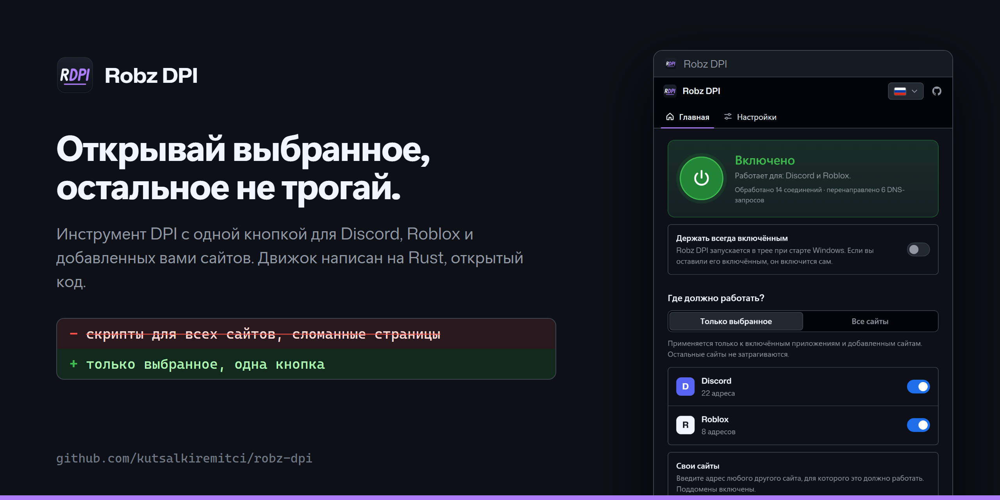
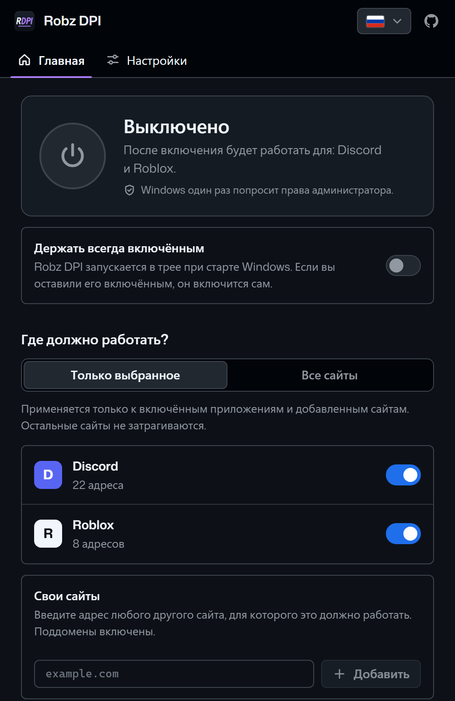
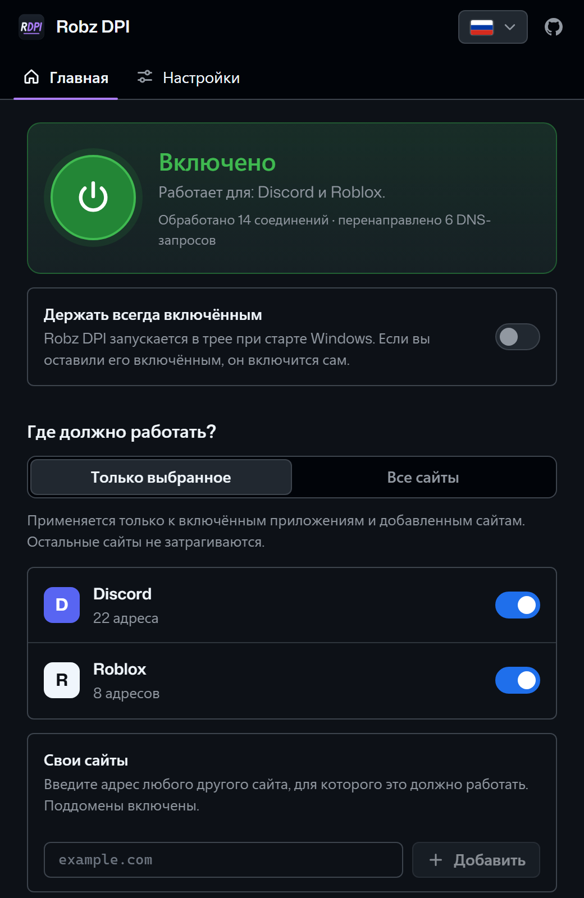
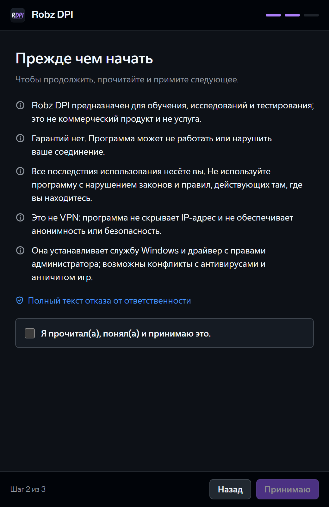
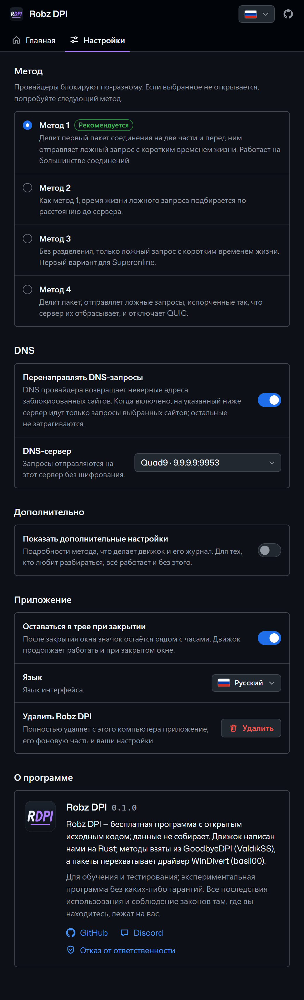
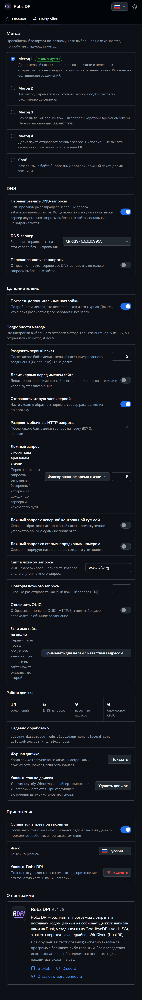

<p align="center">
  
</p>

<p align="center">
  <a href="https://github.com/kutsalkiremitci/robz-dpi/releases/latest"></a>
  <a href="https://github.com/kutsalkiremitci/robz-dpi/releases"></a>
  <a href="https://github.com/kutsalkiremitci/robz-dpi/stargazers"></a>
  <a href="LICENSE"></a>
  <br>
  
  
  
  
  
</p>

<p align="center">
  <a href="https://github.com/kutsalkiremitci/robz-dpi/releases/latest/download/RobzDPI-Setup.exe"></a>
  <a href="https://github.com/kutsalkiremitci/robz-dpi/stargazers"></a>
  <br>
  <a href="README.md"></a>
  <a href="README.en.md"></a>
  <a href="https://discord.gg/UyyEn7SHm4"></a>
</p>

<h3 align="center">Включается одной кнопкой. Работает только для выбранных вами сайтов.</h3>

<p align="center">
  <b>Robz DPI</b> — небольшое приложение для Windows, написанное на <b>Rust</b>. Оно позволяет открывать сайты,<br>
  которые провайдер блокирует с помощью глубокой инспекции пакетов (DPI). Соединение не идёт через сторонний сервер<br>
  и не замедляется: меняется только первый пакет, так что промежуточное устройство его не распознаёт.
</p>

```diff
- Скачать архив, понять, какой .cmd запускать, открыть от имени администратора
- Применяется ко всем сайтам: часть сайтов перестаёт открываться, и непонятно почему
- Чтобы добавить сайт, править текстовый файл; чтобы сменить метод, править флаги
+ Установить Robz DPI и нажать кнопку
+ Применяется только к Discord, Roblox и добавленным вами сайтам; остальное не затрагивается
+ Добавить сайт — ввести адрес в поле; сменить метод — один щелчок
```

> [!WARNING]
> **Для обучения и тестирования; экспериментальный проект.** Robz DPI — проект с открытым исходным кодом, созданный
> для изучения работы сетевых протоколов и систем DPI и для проверки этого в собственной сети. Гарантий нет; все
> последствия использования и соблюдение законов там, где вы находитесь, лежат на вас. Перед использованием
> прочитайте **[отказ от ответственности](DISCLAIMER.md#русский)**.
>
> Движок не проверялся у всех провайдеров. Если у вас не работает,
> [сообщите об этом](https://github.com/kutsalkiremitci/robz-dpi/issues): только так можно узнать, какой метод
> работает на каком соединении.

## Содержание

- [Что умеет](#что-умеет)
- [Начать за 3 шага](#начать-за-3-шага)
- [Руководство](#руководство)
- [Если не работает](#если-не-работает)
- [Как это работает](#как-это-работает)
- [Отличия от GoodbyeDPI](#отличия-от-goodbyedpi)
- [Безопасность и конфиденциальность](#безопасность-и-конфиденциальность)
- [Частые вопросы](#частые-вопросы)
- [Разработка](#разработка)
- [Благодарности](#благодарности)
- [Поддержка и участие](#поддержка-и-участие)
- [Отказ от ответственности](#отказ-от-ответственности)

## Что умеет

<table>
  <tr>
    <td width="33%" valign="top"><b>Одна кнопка</b><br>
      Включить и выключить. Windows один раз попросит права администратора при первом включении; дальше не спрашивает.</td>
    <td width="33%" valign="top"><b>Только выбранное</b><br>
      Discord и Roblox уже готовы. Остальные сайты не затрагиваются, поэтому «этот сайт перестал открываться» не случается.</td>
    <td width="33%" valign="top"><b>Свои сайты</b><br>
      Нужен другой сайт? Введите адрес в поле и добавьте. Не надо править файлы и запоминать флаги.</td>
  </tr>
  <tr>
    <td valign="top"><b>Если хотите, везде</b><br>
      Режим «Все сайты» работает как GoodbyeDPI Turkey: применяется к каждому соединению, без списка.</td>
    <td valign="top"><b>Четыре готовых метода</b><br>
      Провайдеры блокируют по-разному. Если один не сработал, выберите следующий; проверка соединения сразу покажет результат.</td>
    <td valign="top"><b>Исправляет и DNS</b><br>
      Перенаправляет DNS-запросы заблокированных сайтов на выбранный сервер. Затрагиваются только запросы ваших сайтов.</td>
  </tr>
  <tr>
    <td valign="top"><b>Всегда включено</b><br>
      По желанию запускается в трее вместе с Windows и включается сам, если вы оставили его включённым.</td>
    <td valign="top"><b>Раздел «Дополнительно»</b><br>
      Все подробности метода, работа движка и его журнал. Всё работает и без этого раздела.</td>
    <td valign="top"><b>Открытый код, без сбора данных</b><br>
      Нет учётной записи, рекламы и статистики. Весь код, включая движок, в этом репозитории. Турецкий, английский и
      русский языки.</td>
  </tr>
</table>

<p align="center">
  
  
  
</p>

## Начать за 3 шага

1. **Скачайте:** [RobzDPI-Setup.exe](https://github.com/kutsalkiremitci/robz-dpi/releases/latest/download/RobzDPI-Setup.exe)
   (всегда последняя версия).
2. **Установите:** запустите файл. Установка не требует прав администратора и занимает несколько секунд.
3. **Включите:** при первом запуске Robz DPI показывает три коротких шага: язык, согласие с отказом от
   ответственности и где он должен работать. Затем нажмите большую кнопку. Windows спросит «Разрешить этому
   приложению вносить изменения?» — ответьте **Да**. Кнопка станет зелёной.

> [!IMPORTANT]
> Если на компьютере работает **GoodbyeDPI** или похожая программа, сначала закройте её. Две программы меняют один
> и тот же пакет дважды, и соединения ломаются. Robz DPI замечает работающий GoodbyeDPI, предупреждает и может
> остановить его за вас.

## Руководство

### Главная

- **Большая кнопка** включает и выключает движок. Когда он включён, показано, к чему он применяется и сколько
  соединений обработано.
- **Держать всегда включённым:** Robz DPI запускается в трее при старте Windows. Если вы оставили движок
  включённым, он включится сам; если выключенным — останется выключенным.
- **Где должно работать?**
  - **Только выбранное** (рекомендуется): применяется только к включённым приложениям и добавленным сайтам.
  - **Все сайты:** применяется к каждому соединению. Некоторые сайты не принимают разделённое соединение и не
    открываются; тогда вернитесь к «Только выбранное».
- **Свои сайты:** введите адрес (`example.com` или вставьте ссылку) и нажмите **Добавить**. Поддомены
  (`cdn.example.com`) включаются автоматически. Можно добавить сразу несколько адресов через пробел.
- **Проверка соединения:** пробует настоящее соединение с выбранным с этого компьютера.

Если изменить настройку при работающем движке, появится синяя плашка: нажмите **Применить** (смена настроек требует
прав администратора; включение и выключение — нет).

### Настройки

- **Метод:** четыре готовых метода. Метод 1 работает на большинстве соединений. Если нет, пробуйте остальные по
  порядку и после каждого смотрите проверку соединения.
- **DNS:** DNS провайдера возвращает неверные адреса заблокированных сайтов. Robz DPI перенаправляет запросы этих
  сайтов на выбранный сервер (Quad9, Yandex, AdGuard, OpenDNS или свой). Запросы не шифруются.
- Здесь же **поведение при закрытии окна**, **язык** и **удаление Robz DPI**.

### Дополнительно

Включив «Показать дополнительные настройки», вы получите:

- **Подробности метода:** после какого байта делить первый пакет, порядок частей, вид и время жизни ложного
  запроса, сайт в ложном запросе, отключение QUIC и что делать, когда имя сайта не видно. Изменение настройки
  готового метода сохраняет его как «Свой»; готовые методы не меняются.
- **Работа движка:** сколько соединений обработано, сколько DNS-запросов перенаправлено, какие имена сайтов были
  последними.
- **Журнал движка:** когда движок запустился, с каким фильтром и почему остановился.

<p align="center">
  
  
</p>

### Значок в трее

После закрытия окна Robz DPI остаётся в значке рядом с часами. Щёлкните правой кнопкой: **Включить** /
**Выключить**. Движок — отдельная служба Windows: он работает, пока вы его не выключите, даже если полностью выйти
из Robz DPI.

## Если не работает

<details>
<summary><b>Кнопка зелёная, но Discord или сайт всё равно не открывается</b></summary>

1. Нажмите **Проверка соединения**. Если написано «Не открывается», выберите в настройках **следующий метод**,
   нажмите **Применить** и проверьте снова. Попробуйте все четыре.
2. Проверьте, включено ли **Перенаправлять DNS-запросы**. Если да, выберите другой **DNS-сервер**.
3. Если в браузере включён «Безопасный DNS» (DoH), дело не в DNS; сосредоточьтесь на методе.
4. Если ничего не помогло, посмотрите **Работу движка** в разделе «Дополнительно»: растёт ли число соединений?
   Если нет, движок не видит этот сайт (возможно, адрес добавлен неверно). Если растёт, а сайт не открывается,
   метод не работает на этом соединении: [создайте issue](https://github.com/kutsalkiremitci/robz-dpi/issues),
   указав провайдера и приложив журнал движка.

</details>

<details>
<summary><b>Написано «Не удалось запустить движок» или «Движок остановился сам»</b></summary>

Причина указана под сообщением. Чаще всего:

- **Защитная программа заблокировала драйвер:** добавьте Robz DPI в исключения антивируса. Некоторые антивирусы
  (по сообщениям пользователей GoodbyeDPI — особенно Kaspersky) могут блокировать WinDivert несмотря на исключение.
- **Загружена несовместимая версия WinDivert:** закройте программу, которая её использует (старый GoodbyeDPI,
  zapret), и перезагрузите компьютер.
- **Windows не приняла подпись драйвера:** обновите Windows.

</details>

<details>
<summary><b>Появляется «Система Windows защитила ваш компьютер»</b></summary>

Установщик не подписан платным сертификатом, поэтому Windows SmartScreen показывает это предупреждение первым
скачавшим. Нажмите **Подробнее** → **Выполнить в любом случае**. Чтобы убедиться, что файл взят из этого
репозитория, сравните его с `SHA256SUMS.txt` на странице выпуска.

</details>

<details>
<summary><b>Антивирус выдал предупреждение</b></summary>

Robz DPI перехватывает пакеты с помощью драйвера [WinDivert](https://github.com/basil00/WinDivert). Как и любой
инструмент, способный менять сетевой трафик, WinDivert помечается некоторыми антивирусами как «рискованная
программа»; так происходит со всеми программами, которые его используют, включая GoodbyeDPI. Файлы WinDivert в
установщике — официальный выпуск, проверенный по контрольным суммам SHA-256 ([`engine.lock.json`](engine.lock.json)).

</details>

<details>
<summary><b>В режиме «Все сайты» некоторые сайты не открываются</b></summary>

Некоторые сайты отклоняют соединение, разделённое на две части. Это свойство самого метода, и именно поэтому
Robz DPI по умолчанию применяется только к выбранным сайтам. Вернитесь к «Только выбранное» и добавьте нужные сайты.

</details>

<details>
<summary><b>Как полностью удалить Robz DPI?</b></summary>

Настройки → **Удалить Robz DPI**. Одним действием удаляется всё: приложение, его фоновая часть (служба Windows,
драйвер WinDivert, папка `Program Files\RobzDPI`) и настройки. Фоновая часть устанавливалась с правами
администратора, поэтому Windows один раз попросит подтверждение.

Удаление через список «Приложения» Windows делает то же самое: программа удаления убирает и фоновую часть. Если
ответить «Нет» на запрос подтверждения, приложение всё равно удалится, но служба останется.

</details>

## Как это работает

При подключении к сайту браузер сначала отправляет пакет с именем сайта (TLS ClientHello). Устройство провайдера
читает имя в этом пакете и обрывает соединение, если сайт заблокирован. Robz DPI отправляет этот пакет в таком
виде, что устройство его не распознаёт, а сервер сайта понимает без труда:

1. **Делит его.** Пакет разрезается на две части, и вторая отправляется первой. Сервер расставляет части по
   порядку; промежуточное устройство не видит имя целиком.
2. **Ставит перед ним ложный запрос.** Отправляется ложный пакет с именем незаблокированного сайта. Он либо
   исчезает по пути, не дойдя до сервера (короткое время жизни), либо испорчен так, что сервер его отбрасывает;
   промежуточное устройство принимает его за настоящий.
3. **Исправляет DNS.** Запрос адреса заблокированного сайта перенаправляется на сервер и порт, в которые провайдер
   не вмешивается, а ответ возвращается приложению так, будто пришёл оттуда, куда оно обращалось.

Остальная часть соединения не затрагивается: скорость не падает, трафик не идёт через другой сервер. Поэтому это не
VPN: IP-адрес не скрывается, обходится только блокировка.

Движок состоит из двух частей. Подписанный драйвер, который берёт пакеты из ядра и возвращает их, — это
**WinDivert** (basil00, открытый код). Код, решающий, что делать с пакетом, находится в этом репозитории
([`src-tauri/src/engine`](src-tauri/src/engine)):

| Файл | Что делает |
|---|---|
| `packet.rs` | Читает, делит и собирает пакеты IP, TCP и UDP; считает контрольные суммы |
| `tls.rs` | Читает имя сайта из ClientHello; создаёт ложный ClientHello |
| `dnsmsg.rs` | Читает имя в DNS-запросе и адреса в ответе |
| `logic.rs` | Решение: что делать с пакетом? (чистая логика, тестируется без сети) |
| `filter.rs` | Фильтр для драйвера: какие пакеты доходят до движка |
| `divert.rs` | Привязка к WinDivert |
| `service.rs` | Служба Windows: взять пакет, принять решение, вернуть |

## Отличия от GoodbyeDPI

Методы Robz DPI взяты из [GoodbyeDPI](https://github.com/ValdikSS/GoodbyeDPI); они заново написаны на Rust по его
исходному коду. Четыре готовых метода ведут себя как наборы флагов из скриптов
[GoodbyeDPI-Turkey](https://github.com/cagritaskn/GoodbyeDPI-Turkey):

| Robz DPI | Аналог в GoodbyeDPI |
|---|---|
| Метод 1 | `-5 --set-ttl 5` |
| Метод 2 | `-5` |
| Метод 3 | `--set-ttl 3` |
| Метод 4 | `-9` |

Что изменилось после написания движка с нуля:

| | GoodbyeDPI | Robz DPI |
|---|---|---|
| Пакеты, доходящие до движка | Все пакеты меньше 1200 байт на порты 80 и 443 | Только первый пакет соединения (ClientHello); отбор происходит в драйвере |
| Перенаправление DNS | Все запросы | Только запросы выбранных сайтов (или все, если нужно) |
| Имя сайта во втором пакете | В режиме списка соединение не обрабатывается | Адрес цели узнаётся из ответа DNS, и метод применяется |
| Код, читающий пакеты | C | Безопасный Rust (без `unsafe`), проверяется на испорченных данных |
| Автоматическое время жизни, сервер в 3 переходах | Число переполняется; ложный пакет может дойти до сервера | Исправлено |
| Что значит «работает» | Процесс запущен | Драйвер действительно открыт; если нет, сообщается причина |
| Смена настроек | Флаги командной строки, текстовый файл | Интерфейс |

GoodbyeDPI — проверенная программа, которой пользуются много лет; Robz DPI — новый проект. Если GoodbyeDPI у вас
работает, а Robz DPI с тем же методом нет, это наша ошибка:
[сообщите о ней](https://github.com/kutsalkiremitci/robz-dpi/issues).

## Безопасность и конфиденциальность

- **Данные не собираются.** Нет учётной записи, рекламы, статистики и проверки обновлений. Robz DPI выходит в сеть
  только в двух случаях: к выбранным сайтам при нажатии «Проверка соединения» и к выбранному DNS-серверу, пока
  включено перенаправление DNS.
- **Движок только меняет пакет.** Он не читает, не сохраняет и никуда не отправляет содержимое. Соединения не
  расшифровываются.
- **Единственный сторонний двоичный файл — WinDivert.** Он скачивается из официального выпуска, его контрольные
  суммы SHA-256 закреплены в [`engine.lock.json`](engine.lock.json) и проверяются при сборке и при установке
  движка. Сам движок собирается из кода этого репозитория.
- **Права администратора только когда нужно.** Интерфейс работает без привилегий. Установка движка и смена его
  настроек требуют подтверждения Windows (UAC); эта работа выполняется в отдельном режиме без окна, и каждое
  значение из интерфейса проверяется заново. Свободный текст и флаги командной строки не принимаются.
- **Служба запускается из защищённой папки.** Движок копируется в `Program Files\RobzDPI`, изменять которую могут
  только администраторы. Пользователь может запускать и останавливать службу, но не может изменить запускаемую ею
  программу.

## Частые вопросы

<details>
<summary><b>Robz DPI платный?</b></summary>

Нет. Он бесплатный и с открытым исходным кодом (MIT). Нет платной версии, рекламы и учётной записи.

</details>

<details>
<summary><b>Это VPN? Интернет станет медленнее?</b></summary>

Это не VPN. Трафик не идёт через другой сервер, IP-адрес не меняется, скорость не падает. Robz DPI затрагивает
только первый пакет каждого соединения.

</details>

<details>
<summary><b>Работают ли голос в Discord и игра в Roblox?</b></summary>

Голосовой и игровой трафик идёт отдельным путём (UDP), и Robz DPI его не трогает. Блокировка обычно применяется при
подключении к сайту и серверам входа, поэтому ожидается, что после их открытия заработают и голос, и игра; но это
проверялось не на всех соединениях. Если у вас не работает,
[сообщите](https://github.com/kutsalkiremitci/robz-dpi/issues).

</details>

<details>
<summary><b>Какие сайты можно добавить?</b></summary>

Любые. В Robz DPI нет списка заблокированных сайтов; Discord и Roblox — лишь готовые ярлыки.

</details>

<details>
<summary><b>Работает ли в macOS или Linux?</b></summary>

Пока только Windows 10 и 11 (64 бита). Логика работы с пакетами собирается и тестируется на любой платформе; не
хватает слоя, который перехватывает пакеты в этих системах. Следующая цель — macOS.

</details>

<details>
<summary><b>Это законно?</b></summary>

Это зависит от того, где вы находитесь и для чего используете программу; этот репозиторий не даёт юридических
консультаций. Robz DPI — сетевой инструмент для обучения и тестирования: как и где он используется, отвечает
пользователь. Если сомневаетесь, не используйте его и обратитесь к юристу. Подробнее:
[отказ от ответственности](DISCLAIMER.md#русский).

</details>

## Разработка

**Требуется:** [Rust](https://rustup.rs) (MSVC), Node.js 22+, инструменты C++ из Visual Studio и Windows SDK
([предварительные требования Tauri для Windows](https://tauri.app/start/prerequisites/)).

```powershell
npm install          # копирует библиотеки интерфейса, скачивает и проверяет WinDivert
npm run dev          # запуск в режиме разработки
npm test             # тесты интерфейса (node --test) и Rust (cargo test)
npm run build        # установщик: src-tauri/target/release/bundle/nsis/
```

- **Движок тестируется без сети.** `logic.rs` — чистая логика: тесты подают вручную собранные пакеты и проверяют
  выходящие (порядок, место разделения, время жизни, контрольную сумму). Фильтры компилируются настоящим
  `WinDivert.dll` и применяются к примерам пакетов; драйвер не загружается.
- **Интерфейс можно открыть в браузере.** Откройте папку `ui/` любым локальным сервером
  (`python -m http.server --directory ui`), и вместо настоящего ядра подключится имитация
  ([`ui/js/dev-mock.js`](ui/js/dev-mock.js)).
- `node scripts/screenshots.mjs` заново создаёт снимки в [`docs/screenshots`](docs/screenshots) на трёх языках,
  `node scripts/render-banners.mjs` — изображения для README, `node site/build.mjs` — сайт.

**Выпуск версии:** укажите одинаковый номер версии в `package.json`, `src-tauri/Cargo.toml` и
`src-tauri/tauri.conf.json`, запишите заметки в [`CHANGELOG.md`](CHANGELOG.md) и отправьте тег `vX.Y.Z`.

## Благодарности

- **[GoodbyeDPI](https://github.com/ValdikSS/GoodbyeDPI)** (ValdikSS): источник методов. Движок Robz DPI написан по
  его исходному коду.
- **[GoodbyeDPI-Turkey](https://github.com/cagritaskn/GoodbyeDPI-Turkey)** (Çağrı Taşkın): наборы флагов, работающие
  у провайдеров Турции.
- **[WinDivert](https://github.com/basil00/WinDivert)** (basil00): драйвер, перехватывающий пакеты.

Подробности о лицензиях: [THIRD-PARTY-NOTICES.md](THIRD-PARTY-NOTICES.md).

## Поддержка и участие

- **Не получается установить?** На сервере [Discord](https://discord.gg/UyyEn7SHm4) есть бесплатная поддержка.
- **Не работает или есть идея?** [Создайте issue](https://github.com/kutsalkiremitci/robz-dpi/issues). Укажите
  провайдера, опробованные методы и приложите журнал движка — так решить проблему гораздо быстрее.
- **Понравилось?** Звезда репозиторию помогает другим найти проект.

Участие приветствуется: код, перевод, новый метод или сведения о том, что работает у конкретного провайдера.

## Отказ от ответственности

Полный текст: **[DISCLAIMER.md](DISCLAIMER.md#русский)** (турецкий, английский, русский). Скачивая, устанавливая
или используя Robz DPI, вы принимаете этот текст; приложение также просит согласие при первом запуске. Кратко:

- **Для обучения, исследований и тестирования.** Это не коммерческий продукт и не услуга.
- **Гарантий нет.** Программа предоставляется «как есть».
- **Ответственность несёт пользователь.** Все правовые, административные, уголовные, финансовые и технические
  последствия использования лежат на пользователе. Не используйте программу с нарушением законов и решений судов и
  органов власти там, где вы находитесь.
- **Никого не побуждает.** Владелец проекта и участники никого не направляют нарушать законы, ограничения доступа
  или условия сторонних сервисов. В программе нет списка «заблокированных сайтов»; домены выбирает пользователь.
- **Это не услуга.** Не VPN, не прокси и не сервис доступа; трафик не проходит через серверы проекта. IP-адрес не
  скрывается, анонимность и безопасность не обеспечиваются.
- **Есть технические риски.** Используются служба с правами администратора и драйвер ядра; возможны перебои
  соединения, конфликты с другими программами и античит-системами игр.
- **Нет связи с третьими сторонами.** Discord и Roblox — товарные знаки их владельцев; проект с ними не связан.

## Лицензия

[MIT](LICENSE). WinDivert распространяется по собственной лицензии (LGPL-3.0 или GPL-2.0); GoodbyeDPI, источник
методов, — по Apache-2.0. Подробнее: [THIRD-PARTY-NOTICES.md](THIRD-PARTY-NOTICES.md).
